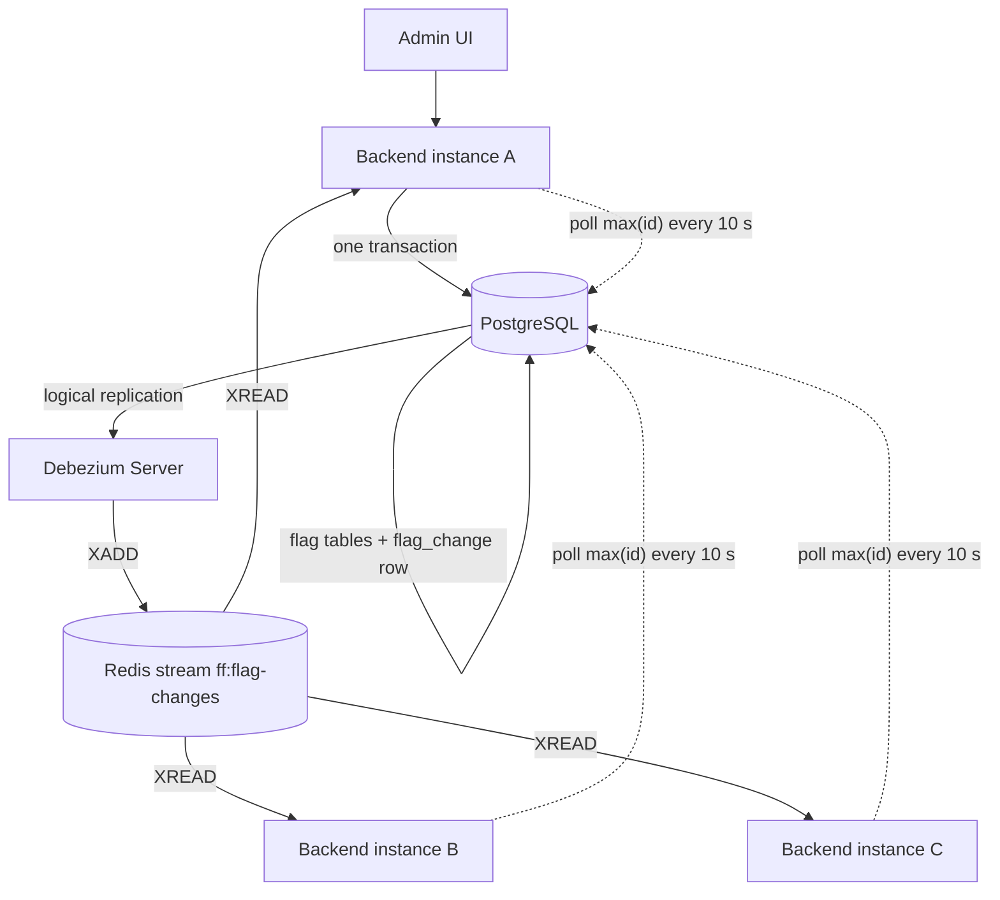

# Spec 003 — High availability (release 1.2.0)

**DRAFT for owner review.** Not yet accepted. Decision: `decisions/0011-high-availability.md`.
Milestone: **M10**. Working branch: **`feature/high-availability`** (from `main`), one PR to `main`.
Spec folder (`<spec>` below): `docs/specs/003-high-availability/`.

This is a change spec, executed by an autonomous builder session. Every "MUST" is a hard
requirement. Items marked **OPEN** are decisions for the owner (section 9).

## 1. Relation to `docs/SPEC.md`

`docs/SPEC.md` (spec 001) and spec 002 still apply. This spec changes only what it names. Where it
names a part of `docs/SPEC.md`, this spec wins for M10.

| `docs/SPEC.md` part | Change in M10 |
| --- | --- |
| 1.2 Non-goals: "Distributed cache … and horizontal scaling" | Removed. The service MAY run as several instances. A distributed *cache* stays out of scope: each instance keeps its own Caffeine cache |
| 2 Tech stack | Adds Redis 7 (stream only, no cache use), Debezium Server, Spring Data Redis |
| 4.1 Tables | Adds table `flag_change` (the outbox, section 5.1), Flyway `V3` |
| 7.2 Caching: "Scope" paragraph and the `revision` rules | Replaced by sections 5.4 and 5.5 of this spec |
| 7.2 Daily reconciliation | Runs in every instance on its own cache; a found drift writes a `RECONCILE` outbox row (5.7) |
| 9.3 Observability | Adds the metrics of 5.9. `/actuator/health` body is unchanged |
| 9.4 Configuration | Adds the variables of 5.10 |
| 10.3 docker-compose | Adds `redis`, `debezium`, a second backend (5.11) |
| 11.3 gate 4 Banned dependencies | `redis` and `lettuce` leave the list (Spring Data Redis uses Lettuce). `jedis`, `hazelcast`, `kafka`, `rabbitmq`, `jjwt` stay banned |
| 12.2 Milestones | Adds M10 (this spec) |

After the PR is merged, the owner updates `docs/SPEC.md` to match. The agent never edits
`docs/SPEC.md` or this file.

## 2. Goal

Run the backend as two or more instances behind a load balancer, so a crash, a deploy or a
restart of one instance does not interrupt clients. **No change in behaviour for clients**:
same API, same payloads, same `ETag` format, same security.

Not in scope: Keycloak or other auth changes, targeting or rollouts, multiple environments,
a distributed cache, client SDKs, PostgreSQL high availability (replication, failover).

## 3. Architecture

Flow of one change:

1. An admin write runs in one transaction: the flag change, the audit row (as today) and one
   `flag_change` row. The id of the `flag_change` row is the new **revision**.
2. After commit, the writing instance updates its own cache and its `revision` synchronously,
   as in spec 001 7.2. The HTTP response returns afterwards.
3. Debezium Server reads the new `flag_change` row from the PostgreSQL log and appends one entry
   to the Redis stream.
4. Every instance reads the stream, applies each entry it has not seen to its cache, and sets
   its `revision` to the entry's revision.
5. Safety net: every instance also polls `max(flag_change.id)` from the database. If it is
   ahead of the local revision for longer than a grace time, the instance reloads its whole
   cache from the database.

Redis and Debezium only speed up step 4. **The database is the source of truth**: if Redis or
Debezium is down, every instance still converges through step 5.

## 4. MUST stay the same

1. Every acceptance criterion of spec 001 (`docs/acceptance-criteria.md`) and spec 002 passes.
2. HTTP behaviour for clients, byte for byte: status codes, headers, problem details, JSON,
   `ETag: "<revision>"` format, `Cache-Control: no-cache`, `304` rules.
3. Security rules of spec 001 section 5, unchanged. No new public endpoint.
4. `backend/openapi.json` unchanged.
5. A single-instance deployment without Redis and Debezium keeps working (5.10, `FF_CLUSTER_ENABLED=false`).
6. All 15 gates, thresholds and test-integrity rules stay as they are, except the banned list
   change in section 1.

## 5. Design

### 5.1 Outbox table `flag_change` (Flyway V3)

| Column | Type | Rule |
| --- | --- | --- |
| `id` | `bigint` generated always as identity | The revision. Strictly increasing. Gaps are allowed |
| `type` | `varchar(20)` not null | `FLAG`, `GROUP`, `RECONCILE` |
| `payload` | `jsonb` not null | The content of the `FlagsChangedEvent` of spec 7.2: keys and new values (section 5.3) |
| `created_at` | `timestamptz` not null | Server time |

- Written by the service in the same transaction as the change and the audit row. Not by a
  database trigger.
- Every change that today increments `revision` writes exactly one row, including a group name
  or description edit. Rejected, failed and no-op writes write nothing.
- V1 and V2 stay unchanged (same checksums). V3 only adds the table.
- Retention: a daily job deletes rows older than `FF_CHANGE_RETENTION` (default `P7D`). The
  newest row is never deleted, so `max(id)` stays valid.

### 5.2 Debezium Server

- Source: PostgreSQL connector, plugin `pgoutput`, table `public.flag_change` only, its own
  publication and replication slot. Sink: Redis stream (`debezium.sink.type=redis`).
- Debezium offsets are stored in Redis (`RedisOffsetBackingStore`) so the container needs no volume.
- One Debezium instance only. It is a singleton by design; if it is down, 5.5 step 5 heals it.
- The PostgreSQL server needs `wal_level=logical`. The compose database service sets it.
- The exact Debezium properties are part of the deliverable (`ops/debezium/application.properties`).
  They MUST produce the entry format of 5.3.

### 5.3 Stream entry contract

Stream `ff:flag-changes`. One entry per `flag_change` row, fields:

| Field | Value |
| --- | --- |
| `revision` | `flag_change.id` as a decimal string |
| `type` | `FLAG`, `GROUP` or `RECONCILE` |
| `payload` | the row's `payload` JSON as a string |

The stream is trimmed to about `FF_STREAM_MAXLEN` entries (default 10000, approximate trim).
The consumer MUST ignore unknown fields (forward compatible).

### 5.4 Revision and ETag

- `revision` is a `long` per instance. It is **never** a local counter. It only takes values that
  come from `flag_change.id`.
- Start-up: after the cache warm-up, `revision = max(flag_change.id)` (0 if the table is empty).
- Own write: after commit, `revision = max(revision, row id)`.
- Stream entry: if `entry.revision > revision`, apply the entry, then `revision = entry.revision`.
  Otherwise ignore the entry (duplicate, replay, or the instance's own change). Applying is
  idempotent.
- `revision` never decreases (AC-HA-9). Gaps in the numbers are fine: the ETag only has to change
  when the data changes.
- `ETag: "<revision>"` and all spec 7.2 header rules stay as they are.

### 5.5 Applying changes in each instance

1. A background reader per instance reads the stream with a blocking `XREAD` and keeps its own
   position in memory. No consumer group (every instance needs every entry).
2. After the start-up warm-up the reader starts at the oldest entry in the stream and skips
   entries with `revision <= revision` (5.4).
3. Entries are applied in stream order with the same copy-on-write updates as the write path
   (spec 7.2 table). `RECONCILE` entries change no cache entry; they only set `revision`.
4. **Gaps:** a jump in the revision numbers is not an error, because rolled-back transactions
   also use sequence values and the stream cannot tell the two cases apart. Lost entries are found by
   the safety net (step 5).
5. **Safety net:** every `FF_CACHE_REVISION_POLL` (default `PT10S`) the instance reads
   `max(flag_change.id)`. If it is greater than the local `revision` and has stayed so for
   `FF_CACHE_CATCHUP_GRACE` (default `PT5S`), the instance reloads all groups and flags from the
   database (like the warm-up), swaps the caches, and sets `revision` to the value it read
   *before* the reload. The reload is logged at WARN and counted (5.9).
6. If applying an entry fails, the instance invalidates the affected entries plus all-flags and
   logs at WARN (as spec 7.2 does).
7. If Redis is not reachable, the reader retries with backoff (1 s up to 30 s). The service keeps
   serving. Redis outage never makes the service return an error to clients.

**Bound on staleness:** normal operation, 2 s (p99). With Redis or Debezium down:
`FF_CACHE_REVISION_POLL + FF_CACHE_CATCHUP_GRACE` (default 15 s) plus the reload time.

### 5.6 Readiness

Readiness is UP after the warm-up, as today. It does **not** depend on Redis or Debezium (a
Redis outage must not take all instances out of the load balancer). `/actuator/health` body stays
exactly as in spec 9.3.

### 5.7 Daily reconciliation

Spec 7.2 stays, with two changes: it runs in **every** instance on that instance's own cache
(no lock), and if it finds any drift it writes one `flag_change` row of type `RECONCILE` so the
`ETag` changes and clients refetch. All instances apply that entry (revision only).

### 5.8 Failure modes

| Failure | Effect | Recovery |
| --- | --- | --- |
| Redis down | No push. Reads and writes keep working | Poll heals within the staleness bound; reader reconnects |
| Debezium down | Rows stay in `flag_change`; the slot keeps WAL | Debezium resumes from its offset; poll heals meanwhile |
| Instance restart | Cache is empty | Warm-up from the database, then stream from the oldest entry |
| Entry duplicated or replayed | None | Ignored by the revision rule |
| Entries lost (Redis failover, trim) | An instance misses changes | Poll sees `max(id)` ahead and reloads |
| Database down | Writes fail (503/500 as today). Reads from cache keep working | Poll resumes when the database is back |
| Debezium stuck, slot growing | WAL grows on the database disk | Alert (5.9); owner action |

### 5.9 Observability

New metrics (Prometheus): `ff_cache_revision` (gauge), `ff_cache_stream_connected` (0 or 1),
`ff_cache_stream_lag_seconds` (age of the last applied entry), `ff_cache_full_reloads_total`,
`ff_cache_entries_applied_total{type}`, `ff_cache_entries_skipped_total`. Alert rules
(`ops/`): stream disconnected for 2 min, full reloads rising, revision differs between
instances for 1 min. Logs keep the ECS format (spec 9.3); each applied entry logs at DEBUG,
each full reload at WARN.

### 5.10 Configuration

| Variable | Default | Purpose |
| --- | --- | --- |
| `FF_CLUSTER_ENABLED` | `false` | `true` turns on the stream reader and the revision poll. `false` = single-instance mode, no Redis needed |
| `FF_REDIS_URL` | `redis://localhost:6379` | Redis for the stream |
| `FF_STREAM_MAXLEN` | `10000` | Approximate stream length |
| `FF_CACHE_REVISION_POLL` | `PT10S` | Safety-net poll |
| `FF_CACHE_CATCHUP_GRACE` | `PT5S` | Wait before a full reload |
| `FF_CHANGE_RETENTION` | `P7D` | Retention of `flag_change` rows |

In single-instance mode (`false`) the service still writes `flag_change` rows (cheap, keeps the
revision rule the same) but runs no reader and no poll.

### 5.11 Deployment (docker-compose, spec 10.3)

- `postgres` with `wal_level=logical`; `redis` with `appendonly yes`; `debezium` (Debezium
  Server image, pinned version); `backend` with `deploy.replicas: 2` (or two named services);
  the UI proxy balances over both backends.
- All images pinned to versions; the new images go through Trivy gate 10 like the others.
- The default `make up` starts the two-instance stack. `FF_CLUSTER_ENABLED=true` there.
- README: how to run one or several instances, and the staleness bound.

### 5.12 Dependencies

`spring-boot-starter-data-redis` (Lettuce) on the backend. Testcontainers for Redis and Debezium
Server in tests. No other new library. The Maven Enforcer list changes as in section 1.

## 6. Acceptance criteria

Registered in `<spec>/acceptance-criteria.md` (`Due milestone: 10`): AC-HA-1 to AC-HA-10.
Each MUST have a test that can fail. Integration tests start two Spring contexts (or two
containers) on one PostgreSQL, one Redis and one Debezium Server (Testcontainers). The
rolling-restart test (AC-HA-8) runs in the Docker smoke or e2e gate, not in unit tests.

## 7. Process

- Rules of spec 001 section 12 and `CLAUDE.md` apply: small green chunks, `make verify-fast`
  per chunk, push at once, owner comments before every commit, escalation flow 12.5.
- Commit messages `M10 <area>: <what>`, trailers `AC:` and `Spec: 003 §<n>`.
- Phases (each chunk green): **A** outbox table and revision rule (no Redis yet, single
  instance, all old tests green); **B** stream reader with an in-test Redis, poll and full reload;
  **C** Debezium and compose, two-instance tests, README, release 1.2.0 (`VERSION`, `CHANGELOG.md`).
- Milestone audit: `spec-auditor`, `test-auditor`, `security-reviewer`, `final-reviewer`
  (scope backend). No separate final review.

**Level 3 triggers for M10** (in addition to spec 001 12.5)

- A change would break an item of section 4.
- Debezium Server cannot produce the entry format of 5.3 (then the owner decides: a small
  transformation, a polling publisher, or another sink).
- The only way to make a gate green is a new exception, exclusion or ignore entry.

## 8. Definition of done

- [ ] `make verify-all` passes, all 15 gates, with the two-instance stack.
- [ ] AC-HA-1 to AC-HA-10 and every spec 001 and 002 criterion have a passing test.
- [ ] `V1` and `V2` unchanged; `V3` only adds `flag_change`; `openapi.json` unchanged.
- [ ] `VERSION` 1.2.0, `CHANGELOG.md` section, README section on multi-instance operation.
- [ ] Milestone audit done, no open BLOCKER or CRITICAL; no open escalation.
- [ ] PR ready for review with a final summary comment.

## 9. Open questions for the owner

1. **Redis licence and distribution:** Redis 7.2 (BSD) or newer under the newer licences, or
   Valkey (BSD)? The spec says "Redis 7"; pin one image.
2. **Stream entry format:** Debezium's outbox event router can shape the entry. Accept it
   if it can produce 5.3, or define the format around what Debezium emits natively?
3. **Staleness bound:** is 2 s normal and 15 s degraded acceptable?
4. **Retention** of `flag_change`: `P7D` is a guess.
5. **Load balancing in compose:** how does the UI proxy (nginx) balance two backends (DNS
   re-resolution or an explicit upstream list)?
6. **Release number:** 1.2.0 (no API change) or 2.0.0 (new infrastructure requirements)?
7. **Reconciliation:** every instance on its own cache (this draft) or one instance under an
   advisory lock? This draft chooses the first, because a lock would leave other instances'
   caches unchecked.
8. **PostgreSQL itself** stays a single point of failure; HA of the database is out of scope.
