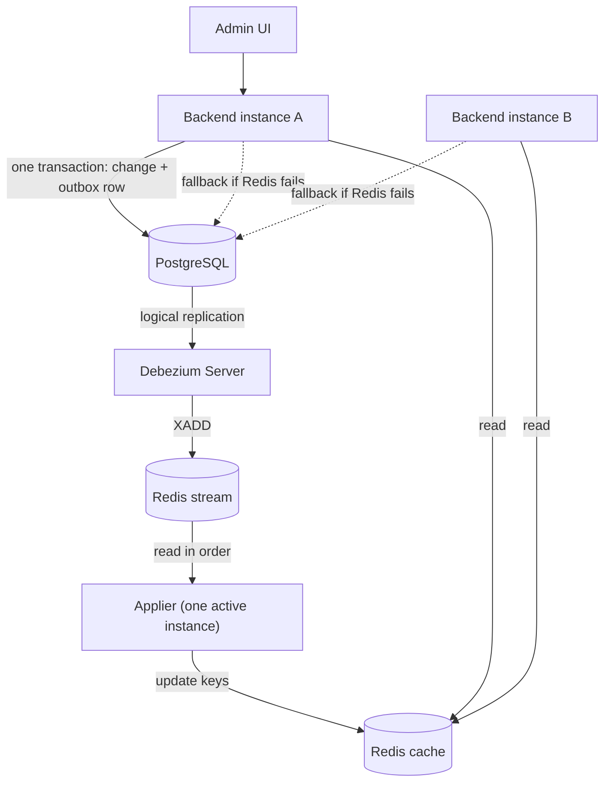

# Spec 003 — High availability with a shared Redis cache (release 1.2.0)

**DRAFT for owner review.** Not yet accepted. Decision: `decisions/0011-high-availability.md`.
Milestone: **M10**. Working branch: **`feature/high-availability`** (from `main`), one PR to `main`.
Spec folder (`<spec>` below): `docs/specs/003-high-availability/`.

This is a change spec, executed by an autonomous builder session. Every "MUST" is a hard
requirement. Items marked **OPEN** are decisions for the owner (section 9).

## 1. Relation to `docs/SPEC.md`

`docs/SPEC.md` (spec 001) and spec 002 still apply. This spec changes only what it names. Where it
names a part of `docs/SPEC.md`, this spec wins for M10.

| `docs/SPEC.md` part | Change in M10 |
| --- | --- |
| 1.2 Non-goals: "Distributed cache … and horizontal scaling" | Removed. The flag cache moves to Redis, shared by all instances. The service MAY run as several instances |
| 2 Tech stack: Cache | Caffeine is replaced by Redis 8 (Spring Data Redis). Adds Debezium Server |
| 4.1 Tables | Adds table `flag_change` (the outbox, 5.1), Flyway `V3` |
| 7.2 Caching | Replaced by sections 5.4 to 5.9 of this spec. The Evaluation API answers from Redis, with the database as fallback |
| 9.3 Observability | Adds the metrics of 5.11. `/actuator/health` body is unchanged |
| 9.4 Configuration | Adds the variables of 5.12 |
| 10.3 docker-compose | Adds `redis`, `debezium`, a second backend (5.13) |
| 11.3 gate 4 Banned dependencies | `redis` and `lettuce` leave the list. `jedis`, `hazelcast`, `kafka`, `rabbitmq`, `jjwt` stay banned. `caffeine` is removed from the dependencies |
| 11.2 AC-CACHE-1 to AC-CACHE-9 | Re-expressed for the Redis cache (table in section 6). The owner extends `docs/acceptance-criteria.md` |
| 12.2 Milestones | Adds M10 (this spec) |

After the PR is merged, the owner updates `docs/SPEC.md` and `docs/acceptance-criteria.md` to
match. The agent never edits them or this file.

## 2. Goal

Run the backend as two or more instances behind a load balancer, so a crash, a deploy or a restart
of one instance does not interrupt clients. All instances read the flags from **one shared Redis
cache**, so there is no per-instance cache to keep in step. **No change for clients**: same API,
payloads, `ETag` format and security.

Not in scope: Keycloak or other auth changes, targeting or rollouts, multiple environments, client
SDKs, high availability of PostgreSQL and of Redis itself (the compose file runs one of each;
Redis Sentinel or Cluster is a later spec).

## 3. Architecture

1. An admin write runs in one transaction: the flag change, the audit row and one `flag_change`
   (outbox) row. The request path does not write to Redis.
2. Debezium Server reads the new outbox row from the PostgreSQL log and appends it to a Redis stream.
3. The **applier** (one instance at a time) reads the stream in order and updates the cache keys
   in Redis. Every applied entry also moves the cache `revision` (the ETag) by one.
4. Every Evaluation API request, on any instance, reads from Redis. If Redis fails or the cache is
   not ready, the instance answers from the database (slower, always correct).

## 4. MUST stay the same

1. Every acceptance criterion of spec 001 and spec 002 passes, except those re-expressed in
   section 6 (AC-CACHE-2, 3, 4, 6).
2. HTTP behaviour for clients, byte for byte: status codes, headers, problem details, JSON,
   `Cache-Control: no-cache`, `304` rules, `ETag: "<n>"` format. One exception, see 5.6
   (ETag of an answer given from the database).
3. Security rules of spec 001 section 5. No new public endpoint.
4. `backend/openapi.json` unchanged.
5. All 15 gates, thresholds and test-integrity rules stay as they are, except the banned list in
   section 1.

## 5. Design

### 5.1 Outbox table `flag_change` (Flyway V3)

| Column | Type | Rule |
| --- | --- | --- |
| `id` | `bigint` generated always as identity | Unique. **Not** the revision (see 5.5) |
| `type` | `varchar(20)` not null | `FLAG`, `GROUP`, `RECONCILE` |
| `payload` | `jsonb` not null | What changed: keys and new values, the content of today's `FlagsChangedEvent` |
| `created_at` | `timestamptz` not null | Server time |

- Written by the service in the same transaction as the change and the audit row (not by a trigger).
- Every change that today increments `revision` writes exactly one row (a group name or description
  edit too). Rejected, failed and no-op writes write nothing. A rolled-back write leaves no row.
- V1 and V2 unchanged (same checksums). Retention: a daily job deletes rows older than
  `FF_CHANGE_RETENTION` (default `P7D`).

### 5.2 Debezium Server

Source: PostgreSQL connector, plugin `pgoutput`, table `public.flag_change` only, own publication
and slot. Sink: Redis stream (`debezium.sink.type=redis`); offsets in Redis
(`RedisOffsetBackingStore`). One instance only. PostgreSQL runs with `wal_level=logical`. The
properties are a deliverable (`ops/debezium/application.properties`).

### 5.3 Stream entry contract

Stream `ff:v1:changes`, one entry per `flag_change` row: fields `id`, `type`, `payload` (JSON as a
string). The reader ignores unknown fields. Entry shaping (decided): first test Debezium's outbox
event router; fall back to the raw change event mapped to the same three fields (section 9, item 2).
The stream is trimmed to about `FF_STREAM_MAXLEN` entries (default 10000).

### 5.4 Redis cache layout

All keys start with `ff:v1:`. The builder chooses the exact key types within these rules:

- R1. One atomic Redis call (a Lua script) returns the data **and** the revision for any of the three
  Evaluation endpoints, so an answer never mixes data and ETag of two moments.
- R2. The cache holds a **complete** copy of all groups and flags. While the marker `ready` exists, a
  key that is not in Redis does not exist: answer 404 without asking the database. No per-key loading
  and no negative entries.
- R3. The marker `ready` is set only after a full build (5.8) and removed by nothing but a flush.
  If Redis restarts empty, `ready` is missing and instances answer from the database until the
  applier has rebuilt the cache.
- R4. Values are immutable per apply; one apply = one Lua call that changes data, the revision and
  the stream position together (5.7).
- Size: up to 1,000 groups with 500 flags each (spec 9.2) must fit; reads of one group or all flags
  must stay under the 50 ms p95 target of spec 9.2.

### 5.5 Revision and ETag

- `revision` is a counter **inside Redis**, increased by 1 by the applier for every applied entry,
  in the same Lua call as the data change. All instances read the same value, so all instances
  return the same `ETag: "<revision>"` for the same data.
- It is **not** the outbox `id`: identities are handed out when a transaction starts, but changes
  become visible in commit order, so ids can arrive out of order. The stream order (commit order)
  is the only safe order.
- After a full build (5.8) the counter is set to `max(flag_change.id)` of the database (0 if empty).
  Every applied entry used one distinct id, so the counter never exceeds that number: the value
  never repeats for different data after a Redis restart.
- A `RECONCILE` entry (5.9) only increases the revision.

### 5.6 Read path

1. Call Redis (R1). Cache ready and call succeeded: answer from the result (hit).
2. Redis error, timeout (`FF_REDIS_TIMEOUT`, default `PT0.5S`) or `ready` missing: answer from the
   database (spec 7.2 loaders, one query per request) and count a fallback. The `ETag` of such an
   answer is `"d<max(flag_change.id)>"` (the `d` prefix cannot equal a Redis ETag). A client then
   gets one full 200 and goes back to normal ETags when Redis is back. **OPEN** (section 9, item 9).
3. No retry storm: after a Redis error the instance skips Redis for `FF_REDIS_RETRY` (default
   `PT2S`), then tries again with one request.
4. The Admin API reads the database as today.

### 5.7 Applier

- One active applier at a time: an instance takes the lock `ff:v1:applier` (`SET NX PX 10000`) and
  renews it every 3 s. If it dies or loses the lock, another instance takes over after the lock expires.
- The applier reads the stream in order from the position stored in `ff:v1:pos`. For every entry
  one Lua call: checks the lock token, applies the data change, increases `revision`, stores the new
  position. If the token is no longer valid the call does nothing (no two appliers).
- Applying is "set to the value in the payload", so re-applying an entry gives the same data.
- Staleness while the applier is dead: up to 10 s (lock expiry) plus start-up of the new one.

### 5.8 Full build (empty or flushed Redis)

Done by the applier when `ready` is missing, and also at the first start:
1. Remember the current end of the stream.
2. Read all groups and flags from the database in one transaction.
3. Write them to Redis, set the revision (5.5), set `pos` to the remembered end, then set `ready`.
4. Continue reading the stream from `pos`. Entries that were already in the database snapshot are
   applied again. For a moment a value may go back to an older state and then forward again (the
   last entry of a key always matches the database); no entry is skipped.

### 5.9 Daily reconciliation

The applier instance compares Redis with the database once a day (cron `FF_CACHE_RECONCILE_CRON`),
fixes every difference, logs each at WARN, and writes one `RECONCILE` outbox row if it found any,
so the ETag changes. Metrics as spec 7.2. A run with no difference logs nothing and keeps the ETag.

### 5.10 Readiness

Readiness is UP when the application has started and the database is reachable. It does not wait
for Redis (a Redis outage must not take instances out of the load balancer: they still answer from
the database). `/actuator/health` body stays as in spec 9.3.

### 5.11 Observability

New metrics: `ff_cache_requests_total{result=hit|fallback}`, `ff_cache_ready` (0 or 1),
`ff_cache_revision`, `ff_applier_active` (0 or 1 per instance), `ff_applier_lag_seconds`,
`ff_applier_applied_total{type}`, `ff_cache_full_builds_total`. `cache_gets_total` of spec 9.3 is
kept (hit or fallback). Alert rules (`ops/`): no active applier for 1 min, applier lag over 30 s,
fallback share over 1 % for 5 min.

### 5.12 Configuration

| Variable | Default | Purpose |
| --- | --- | --- |
| `FF_REDIS_URL` | `redis://localhost:6379` | The shared cache and the stream |
| `FF_REDIS_TIMEOUT` | `PT0.5S` | Per call; on timeout the request goes to the database |
| `FF_REDIS_RETRY` | `PT2S` | Pause before trying Redis again after an error |
| `FF_STREAM_MAXLEN` | `10000` | Approximate stream length |
| `FF_CHANGE_RETENTION` | `P7D` | Retention of `flag_change` rows |

### 5.13 Deployment (docker-compose)

`postgres` with `wal_level=logical`; `redis` (Redis 8, pinned) with `appendonly yes`; `debezium`
(pinned); `backend` with two replicas; the UI proxy balances over both. All images pinned and
scanned by gate 10. README documents running one or several instances.

### 5.14 Dependencies

`spring-boot-starter-data-redis` (Lettuce). Caffeine is removed. Testcontainers for Redis (and
Debezium Server for the end-to-end tests).

## 6. Acceptance criteria

Registered in `<spec>/acceptance-criteria.md` (`Due milestone: 10`): AC-HA-1 to AC-HA-11.

**Spec 001 criteria that change** (the owner extends `docs/acceptance-criteria.md`):

| ID | Now | Becomes |
| --- | --- | --- |
| AC-CACHE-1 | After warm-up, 1,000 evaluation calls run zero database queries | Same, with the cache ready in Redis |
| AC-CACHE-2 | One database query for two concurrent reads of an evicted entry | **Removed** (no per-key loading; the cache is complete) |
| AC-CACHE-3 | Unknown key read twice runs one database query | **Removed**. Becomes: with the cache ready, an unknown key is 404 with zero database queries |
| AC-CACHE-4 | A change is visible on the next evaluation call, zero database queries | Visible within 2 s (p99) on any instance, zero database queries for that call |
| AC-CACHE-5 | A rolled-back write leaves the cache unchanged | Same: no outbox row, Redis unchanged |
| AC-CACHE-6 | Readiness DOWN until warm-up finishes | Readiness DOWN until the application has started and the database is reachable (5.10) |
| AC-CACHE-7, 8, 9 | Reconciliation and hit rate | Same, against Redis (hit rate = share of reads answered by Redis) |

## 7. Process

- Rules of spec 001 section 12 and `CLAUDE.md` apply. Commit messages `M10 <area>: <what>`, trailers
  `AC:` and `Spec: 003 §<n>`.
- Phases, each chunk green: **A** outbox table and writing the rows (Caffeine still in place, all old
  tests green); **B** Redis cache, read path with fallback, applier and full build, tests with a Redis
  container and a test publisher that writes the stream entries; **C** Debezium, compose with two
  instances, the end-to-end tests, README, release 1.2.0 (`VERSION`, `CHANGELOG.md`).
- Milestone audit: `spec-auditor`, `test-auditor`, `security-reviewer`, `final-reviewer` (backend).

**Level 3 triggers for M10** (in addition to spec 001 12.5)

- A change would break an item of section 4.
- Neither the outbox event router nor the raw change event can be mapped to the entry of 5.3.
- The only way to make a gate green is a new exception, exclusion or ignore entry.

## 8. Definition of done

- [ ] `make verify-all` passes, all 15 gates, with the two-instance stack.
- [ ] AC-HA-1 to AC-HA-11 and every spec 001 and 002 criterion (with section 6 changes) pass.
- [ ] `V1`, `V2` unchanged; `V3` only adds `flag_change`; `openapi.json` unchanged.
- [ ] `VERSION` 1.2.0, `CHANGELOG.md` section, README section on several instances.
- [ ] Milestone audit done, no open BLOCKER or CRITICAL; no open escalation; PR ready with summary.

## 9. Open questions for the owner

1. ~~Redis distribution~~ **Decided: Redis 8** (AGPLv3 option), pinned, unmodified.
2. ~~Stream entry format~~ **Decided: outbox event router first, raw change event as fallback.**
3. **Behaviour change:** after an admin write, the Evaluation API now reflects it within 2 s (p99)
   instead of "before the HTTP response returns" (spec 001 7.2). Acceptable? If not, the write must
   wait until the applier has applied its entry (more code).
4. **Retention** of `flag_change` rows: `P7D` is a guess.
5. **Load balancing in compose:** how does the UI proxy balance two backends (DNS re-resolution or
   an explicit upstream list)?
6. **Release number:** 1.2.0 or 2.0.0 (new infrastructure requirements)?
7. **Debezium down while Redis is up** (no error, no new entries): how do we detect it? To be
   discussed next (heartbeat, a slow check, or an alert only).
8. **Redis and PostgreSQL stay single points of failure** here. Their high availability is a later spec.
9. **ETag during database fallback** (`"d<n>"`, 5.6): accept this one deviation from "ETag format
   byte for byte", or serve fallback answers without caching headers?
10. **Test strategy:** unit and integration tests use a Redis container and a test publisher for the
    stream; only the end-to-end tests start Debezium. OK?
11. **Applier election by a Redis lock** (5.7) versus a database advisory lock: the draft uses Redis
    so it works when the database is busy. OK?
12. **Single-instance mode without Redis is dropped.** Redis is required from M10. OK?
