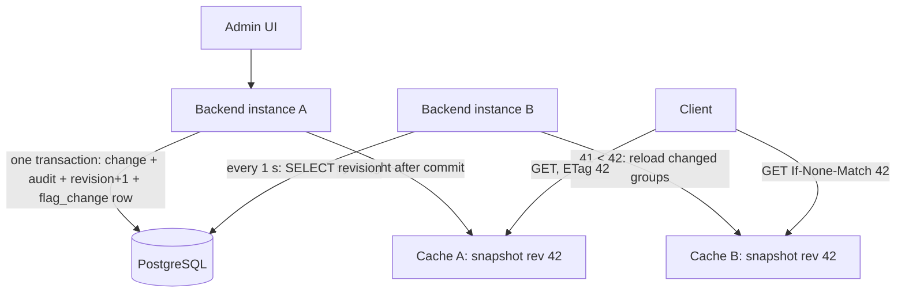

# Spec 003 — High availability

Owner-authored, locked. Facts (status, milestone, branch, release): `spec.json`. Flow:
`docs/process/spec-flow.md`. Spec folder (`<spec>` below): `docs/specs/003-high-availability/`.

This is a change spec, executed by an autonomous builder session. Every "MUST" is a hard
requirement. Section 10 records the owner's decisions.

## 1. Relation to the current docs

`docs/product/` and `docs/architecture/` describe the system. This spec's own commits change
them, so on its branch they already describe the system after the spec. Everything they say that
this spec does not change still applies.

| File | Change |
| --- | --- |
| `docs/product/overview.md` 1.2, 13 | Horizontal scaling is no longer a non-goal; a distributed cache still is. "Multi-instance backend" row: done by this spec |
| `docs/architecture/api.md` 7.2 | Write path, `revision`, "Scope" and "Known limitation" replaced by the database revision, the syncer and the snapshot (4.1 to 4.7); read path: snapshot first, Caffeine only for unknown keys (4.3); reconciliation on every instance without a local patch (4.8); warm-up before the port opens (4.9). No-expiry and `maximumSize` stay |
| `docs/architecture/overview.md` 3 | Request paths: the revision increment in the write transaction, sync after commit and by poll; several instances |
| `docs/architecture/data-model.md` 4.1, 4.3 | Tables `cache_state` and `flag_change`, Flyway `V3` (4.2) |
| `docs/architecture/non-functional.md` 9.3, 9.4 | Sync metrics and the `FFCacheSyncStale` alert (4.10); `FF_CACHE_SYNC_INTERVAL`, `FF_CHANGE_RETENTION` (4.11) |
| `docs/architecture/deployment.md` 10.3 | Two backend services; the UI proxy balances with an `upstream` block; the `make up` check counts every backend (4.12) |

Not changed: gate 4 banned dependencies (no Redis, no broker), `backend/openapi.json`, tech stack,
security rules.

The builder never edits these files, the criteria or this spec. A spec change during the build
is an owner amendment (`docs/process/spec-flow.md` section 2).

## 2. Goal

Run the backend as any number of instances (N ≥ 2) behind a load balancer, so a crash, a deploy or
a restart of one instance does not interrupt clients. **No change for clients**: same API,
payloads, `ETag` format, security. No new component to run.

Not in scope: Keycloak or other auth changes, targeting or rollouts, multiple environments, client
SDKs, high availability of PostgreSQL, a distributed cache.

## 3. MUST stay the same

1. Every acceptance criterion in `docs/project-acceptance-criteria.md` passes at its current
   version, with the changes of section 5.
2. HTTP behaviour for clients, byte for byte: status codes, headers, problem details, JSON,
   `ETag: "<revision>"`, body `revision`, `Cache-Control: no-cache`, `304` rules. One exception,
   backed by AC-HA-4: the monotonic `304` of 4.6. Before warm-up an instance refuses connections
   (4.9); that is not an HTTP change.
3. Security rules of spec 001 section 5 (`docs/architecture/security.md`). No new endpoint.
4. `backend/openapi.json` unchanged.
5. All 16 gates, thresholds, banned lists and test-integrity rules unchanged.
6. Existing Flyway migrations `V1` and `V2` unchanged (same checksums).

## 4. Design

### 4.1 Architecture



1. An admin write runs in one transaction: the flag change, the audit row (as today), one
   increment of `cache_state.revision` under its row lock, and one `flag_change` row carrying the
   new revision. Revision order is therefore commit order, with no gaps.
2. After commit, the writing instance syncs its own cache before the HTTP response returns
   (read-your-write, as today).
3. Every instance runs a **syncer**: every `FF_CACHE_SYNC_INTERVAL` (default 1 s) it reads
   `cache_state.revision` with a plain query from the normal connection pool. If the database is
   ahead, it reloads the changed groups and swaps its in-memory snapshot.
4. Every Evaluation request is answered from the instance's snapshot. `ETag` is the snapshot's
   revision. Instances never talk to each other. Nothing is pushed; nothing can be missed.


### 4.2 Tables (Flyway V3)

`cache_state`: columns `id smallint primary key` (always 1) and `revision bigint not null`.
V3 inserts the single row with `revision = coalesce(max(audit_event.id), 0) + 1000000`. Release
1.1.0 served `max(audit_event.id)` plus its later increments (reconciliation can add some without
an audit row), so the first spec 003 `ETag` is greater than any `ETag` 1.1.0 served: an upgrade
never moves a client's `ETag` down and never reuses a value for other data.

`flag_change`:

| Column | Type | Rule |
| --- | --- | --- |
| `revision` | `bigint primary key` | The value returned by the increment in the same transaction |
| `type` | `varchar(20) not null` | `FLAG`, `GROUP`, `GROUP_DELETED`, `RECONCILE` |
| `group_key` | `varchar(100)` | The group to reload. `null` for `RECONCILE` |
| `created_at` | `timestamptz not null` | Database time (`now()`), so retention does not depend on instance clocks |

- Every change that today increments `revision` (`docs/architecture/api.md` 7.2 table, including a group name or
  description edit) MUST run, inside its transaction and after its data writes:
  `UPDATE cache_state SET revision = revision + 1 WHERE id = 1 RETURNING revision`, then insert
  the `flag_change` row with that value. Rejected, failed and no-op writes do neither. A rollback
  rolls back both.
- **Lock span.** The row lock is held from the `UPDATE cache_state` statement to the commit and
  not longer. The increment and the `flag_change` insert MUST be the last two statements of the
  transaction: validation, the flag or group writes and the audit row run before them, in parallel
  across writers, and nothing may run between the increment and the commit. So writers are
  serialised only for the commit tail (a few ms), not for the whole transaction. `lock_timeout`
  for the increment: 5 s; on timeout the write fails with the existing 500 problem detail (an
  operational fault, not client input). Gate 13 loads only the Evaluation API; the admin p95 is
  checked in the production-like environment (`docs/architecture/non-functional.md` 9.2, decision 0007).
- Retention: a daily job deletes `flag_change` rows older than `FF_CHANGE_RETENTION` (default
  `P1D`). `cache_state` is never reset. This job and the audit purge run on every instance; their
  deletes are idempotent, so no lock is needed.
- Where the code lives: the increment and the insert MAY live in the audit write path
  (`AuditService`), which every revision-changing write already calls as its last data write. In
  the `evaluation` package the database is read only in `FlagCacheService` methods named `load*`
  or `reloadAll` and in `CacheReconciliationJob` (ArchUnit rule of gate 3, unchanged).

**Known limit (owner note).** The single counter row is a serialisation point for all admin
writes. With a commit tail of a few ms it carries roughly a few hundred writes per second before
the queue grows; an admin UI stays far below that. It becomes a bottleneck only with intensive
automated updates on a large flag set. If the production-like check of the admin p95
(`docs/architecture/non-functional.md` 9.2) fails because of this lock, the follow-up would be a different
revision source (for example a sequence plus a "visible up to" marker), not a change to the
read side. Not built in M11.

### 4.3 Snapshot

Each instance holds one immutable `Snapshot { long revision; Map all; Map<group, Map> groups }`
in a `volatile` field. The maps are complete: every group and flag that exists at that revision.
A request reads that one reference, so its data and its `ETag` always come from the same moment.
A swap replaces the whole reference; nothing changes a snapshot in place. This replaces the 1.1.0
ordering of revision and data and the BF-1 workaround (`appliedSeq`, `loadedSeq`, `isLate`) in
`FlagCacheService`.

- A key in the snapshot is answered from it, with no database read.
- A key absent from the snapshot is `404` at the snapshot's revision. Caffeine stays only for this
  path and for the hit metrics: the negative entry (30 s) and the one database read on its miss
  that AC-CACHE-2 and AC-CACHE-3 count. That read never changes the answer or the `ETag`: the
  answer is the snapshot's `404`, and a key that the database already has arrives with the next
  sync. If the read fails (database down), the answer is still the `404` (AC-HA-5).
- A sync that reloads a group drops every negative `flagCache` entry of that group, so a flag
  created on another instance is found right after the sync, not 30 s later (AC-HA-2).
- The builder checks AC-CACHE-2 and AC-CACHE-3 against this model in phase A. If one of them
  cannot hold, that is a Level 3 escalation (an owner amendment), never a weaker test.

### 4.4 Syncer

One per instance, one thread, started after warm-up.

1. Every `FF_CACHE_SYNC_INTERVAL`: `SELECT revision FROM cache_state`. If equal to the local
   revision, done.
2. Otherwise, in **one `REPEATABLE READ` transaction**: read `flag_change` rows with
   `revision > local` ordered by revision; load the groups they name (a `GROUP_DELETED` row removes
   the group); read `cache_state.revision` again; commit. Build the new snapshot from the current
   one plus these groups and swap it. Set local = the revision read inside the transaction.
3. If no `flag_change` row with `revision = local + 1` exists (retention deleted it, or local is
   0), do a **full reload** instead: all groups and flags and `cache_state.revision` in one
   `REPEATABLE READ` transaction, as the warm-up does.
4. A sync never lowers the local revision. A snapshot is swapped only if its revision is greater.
5. Errors: logged at WARN with the gap; the next tick retries. The service keeps serving the current
   snapshot. No backoff below 1 s, no backoff above 10 s.
6. Warm-up (`api.md` 7.2) is a full reload (step 3) and sets the initial local revision.

### 4.5 Writing instance

After commit (the existing `AFTER_COMMIT` listener), the instance runs one sync (4.4 step 1 to 2)
synchronously, before the HTTP response returns. The `FlagsChangedEvent` payload is no longer
applied directly; the sync reloads from the database. The event and its payload are still
published as today. Read-your-write holds on that instance. If this sync fails, the admin call
still returns its normal 2xx (the write is committed); the error is logged at WARN and the next
tick catches up.

### 4.6 ETag and the monotonic rule

- `ETag: "<revision>"` and body `revision` are the snapshot's revision. All instances give the
  same value for the same data; a restart gives the same value too.
- **Monotonic rule.** If a request carries `If-None-Match` with a number **greater** than the
  snapshot's revision, the instance answers `304` with the client's tag
  (`ETag: "<client's number>"`, `Cache-Control: no-cache`, no body) and runs no extra sync and no database read. The
  client already holds data at least as new as anything this instance could return, and the
  syncer catches up within `FF_CACHE_SYNC_INTERVAL`. A client is therefore never shown an older
  revision after it has seen a newer one, whichever instance the load balancer picks. A client
  that sends an invented, too-high number only keeps its own data; it cannot cause database load.
- Matching of `If-None-Match` stays as today: a comma-separated list, weak tags compare equal
  (AC-EVAL-6). The monotonic rule applies only when the header is one tag whose value is a
  decimal number; anything else that does not match is no match.

### 4.7 Consistency bound

Normal operation: a change is visible on the writing instance before the HTTP response returns
and on every other instance within `FF_CACHE_SYNC_INTERVAL` (p99 ≤ 2 s with the default). An
instance that cannot reach the database keeps serving its last snapshot; that data cannot be
stale by a write it missed, because no write can commit without the database. The one stale case
is an instance cut off from the database while the others are not; 4.10 alerts on it.

### 4.8 Daily reconciliation

As in 1.1.0 (`api.md` 7.2), with these changes. Every instance runs it on its own schedule; no
lock is needed.

1. In one `REPEATABLE READ` transaction read `cache_state.revision` and all groups and flags.
2. If that revision is not equal to the local snapshot's revision, skip the compare (a sync is
   due) and retry on the next syncer tick after the local revision has caught up; the run counts
   as done when the compare ran.
3. Compare. Each difference is logged at WARN as today. The local snapshot is **not** patched.
4. Drift found: in one transaction increment `cache_state.revision` and insert a `RECONCILE` row,
   then sync like a writer (4.5). Every other instance does a full reload on its next tick, so
   all serve the corrected data under the new `ETag`.
5. No drift: no row, no revision change (AC-CACHE-8 unchanged).

`ff_cache_reconcile_last_success_seconds` is set by each instance's own completed compare, so
`FFReconcileStale` keeps its meaning per instance.

### 4.9 Readiness

Warm-up runs before the HTTP port opens (for example during context refresh, before the web
server starts), so an instance that is not warm refuses connections and serves nothing from an
empty cache. Readiness is UP once the port is open, after warm-up. It does **not** depend on the
database afterwards: a database outage must not remove every instance from the load balancer while
they can still serve correct data. `/actuator/health` body unchanged. The compose upstream retries
idempotent requests on another backend on `error timeout http_502 http_503 http_504` (4.12).

### 4.10 Observability

New metrics: `ff_cache_revision` (gauge, per instance), `ff_cache_sync_age_seconds` (time since
the last successful sync), `ff_cache_syncs_total{result=noop|partial|full|error}`. Alert rule in
`ops/`: `ff_cache_sync_age_seconds > 30` for 1 min. Logs keep the ECS format; each partial or full
sync logs at DEBUG with the revision range, each error at WARN.

### 4.11 Configuration

| Variable | Default | Purpose |
| --- | --- | --- |
| `FF_CACHE_SYNC_INTERVAL` | `PT1S` | Syncer tick |
| `FF_CHANGE_RETENTION` | `P1D` | Retention of `flag_change` rows |

### 4.12 Deployment

**Images.** The product is the two images `feature-flag-backend` and `feature-flag-ui` plus a
PostgreSQL. They run anywhere Docker runs; instances need only the database, never each other
(AC-OPS-2 stays). `docker-compose.yml` is the local stack and the test rig for the gates and the
acceptance suite, not the deployment model.

**Compose (local, gates).** The services are:

| Service | Role | Host port |
| --- | --- | --- |
| `postgres` | as today | none |
| `backend-1`, `backend-2` | same image, same environment, depend on healthy `postgres` | `${FF_BACKEND_1_PORT:-18081}`, `${FF_BACKEND_2_PORT:-18082}` (direct, for the HA tests) |
| `api-lb` | nginx; proxies `/api/` and `/actuator/` to `backend-1` only | `${FF_BACKEND_PORT:-8080}` |
| `frontend` | the UI image; its `/api/` proxy balances across all backends | `${FF_UI_PORT:-3000}` |

- `api-lb` keeps one fixed backend on `:8080`, so the locked `scripts/owner-review.sh`, smoke,
  perf and every API test that reads right after a write (AC-EVAL-5, AC-EVAL-6) see one
  instance, and `/actuator/prometheus` counters (AC-CACHE-9) come from one instance. Its name is
  not `backend-*`, so "each backend service" never includes it.
- The UI's nginx balances with an explicit `upstream` block. Only that block is mounted, as a
  file in the UI image's `/etc/nginx/conf.d/`, and the `frontend` service sets
  `BACKEND_URL=http://backend`. So the gates test the image's own nginx config (AC-OPS-4 headers,
  413 handling); the image does not change and keeps `BACKEND_URL` as its default (one backend,
  AC-OPS-2 unchanged):

```
upstream backend {
    server backend-1:8080 max_fails=2 fail_timeout=5s;
    server backend-2:8080 max_fails=2 fail_timeout=5s;
}
proxy_next_upstream error timeout http_502 http_503 http_504;   # idempotent requests only (nginx default)
```

  Round-robin; a backend that fails twice is skipped for 5 s. Chosen over DNS-based resolution
  because nginx resolves a name once at start and keeps a stale IP after a container restart
  unless a `resolver` with a short TTL is configured.
- `perf/compose.limits.yml` gives each backend service 1 vCPU / 512 MB. Renaming `backend` to
  `backend-1` or `api-lb` in `perf.sh`, `perf/compose.limits.yml`, `smoke.sh`, `e2e.sh` and
  `scan-images.sh` (gate 10) is plumbing: no check, value or threshold changes.
- Settings for the HA tests (section 7): `docker-compose.yml` passes `FF_CACHE_SYNC_INTERVAL`
  to `backend-2` as `${FF_BACKEND_2_CACHE_SYNC_INTERVAL:-${FF_CACHE_SYNC_INTERVAL:-PT1S}}`, so a
  stack can keep one instance behind (AC-HA-4), and `FF_CACHE_RECONCILE_CRON` to every backend,
  so a stack can reconcile every few seconds (AC-HA-10, AC-CACHE-7).

The `make up` check (AC-OPS-1, `docs/architecture/deployment.md` 10.3) counts every service of the
compose file: `postgres`, `backend-1`, `backend-2`, `api-lb`, `frontend`.

**ECS / Fargate (production reference, not built or tested in M11).** Backend: one task definition,
one service with `desiredCount ≥ 2`, an ALB target group with health check
`/actuator/health/readiness`, container health check `/actuator/health/liveness`. UI: its own
service behind the ALB; its nginx forwards `/api/` to the backend target group's name, so the ALB
does the balancing and no `upstream` block is needed there. Database: RDS for PostgreSQL. Secrets:
Secrets Manager or SSM into the task environment. Images: ECR, tagged as `make build-images` does.
No `depends_on`: the backend retries the database at start and runs Flyway itself. Rolling
deployment with minimum healthy percent 100 is the mixed-deployment case of 4.13.

### 4.13 Upgrade to the spec 003 release

An instance of an older release (without spec 003) writes no `cache_state` increment, so a write
through it during a mixed deployment is invisible to spec 003 instances until reconciliation.
**Decided: stop the old instance before starting the first spec 003 instance** (a short outage,
once). The README MUST state this for the upgrade to the spec 003 release, with its version
number. Rolling deployments between the spec 003 release and later versions are supported (both
write the increment).

## 5. Acceptance criteria

In `docs/project-acceptance-criteria.md` (File 4), due M11. New: AC-HA-1 to AC-HA-10. "N" there
is any instance count ≥ 2; main code MUST NOT assume a fixed count. Integration tests use N = 3;
the compose stack runs N = 2.

- **AC-HA-1** · N instances on one database serve the same flags with the same `ETag`
- **AC-HA-2** · of 100 changes through one instance, 99 are visible on every other within 2 s, zero queries
- **AC-HA-3** · database revision follows commit order, no gaps; a rollback leaves it unchanged
- **AC-HA-4** · monotonic `ETag`: a client ahead of an instance gets `304` with its own tag
- **AC-HA-5** · database down: every instance keeps serving its snapshot, readiness UP, writes fail
- **AC-HA-6** · a restarted or new instance serves the current state and revision when ready
- **AC-HA-7** · an instance lagging more than the retention does a full reload
- **AC-HA-8** · rolling restart through the UI proxy: no 5xx, never a lower revision
- **AC-HA-9** · an instance's revision never decreases, also across restart, full reload and the upgrade from 1.1.0
- **AC-HA-10** · drift found by any instance's reconciliation reaches every instance within 2 s

**Criteria that change** (same ID, same position, version + 1, `changed by spec 003`):

| ID | Now | Becomes |
| --- | --- | --- |
| AC-CACHE-4 | v1: Toggle, create and delete of a flag, and delete of a group, are each visible on the next evaluation call with zero database queries for that call | v2: Same on the instance that made the change; on every other instance within 2 s for at least 99 of 100 changes, with zero database queries for the evaluation call itself |
| AC-CACHE-6 | v1: The readiness probe reports DOWN until warm-up has finished | v2: Not UP until warm-up has finished (before that the instance refuses connections or reports DOWN), and stays UP when the database becomes unreachable after warm-up |
| AC-CACHE-7 | v1: A flag changed directly in the database keeps its old cached value until reconciliation runs; after a reconciliation run, the next evaluation call returns the database value, a WARN is logged and the ETag changes | v2: Same, and every other instance returns the database value within 2 s |
| AC-OPS-1 | v1: `make up` on a clean machine with Docker starts all three containers; UI reachable on port 3000 within 90 s | v2: `make up` starts every service of the compose file (`postgres`, `backend-1`, `backend-2`, `api-lb`, `frontend`); `postgres` and each `backend-<n>` healthy; UI reachable on port 3000 within 90 s |

AC-CACHE-1, 2, 3, 5, 8, 9 and AC-OPS-2, 3, 4 unchanged. Note for the builder: AC-CACHE-1 counts
queries on `EvaluationQueries`; the syncer MUST use its own repository so its tick is not counted.

## 6. Test changes

The tests that may change are listed in `<spec>/test-changes.md`.
Allowed behaviour changes: AC-CACHE-4, AC-CACHE-6, AC-CACHE-7, AC-OPS-1.
Every other test may change only by the plumbing clause in that file. A change to any other
test is a Level 3 escalation (section 8).

## 7. Acceptance delta

For the black-box acceptance suite (`docs/process/validation.md`); the tests name criterion and
version (`[AC-HA-1 v1]`):

- Added: AC-HA-1 … AC-HA-10
- Changed: AC-CACHE-4, AC-CACHE-6, AC-CACHE-7, AC-OPS-1: an N-instance variant (a change on one instance checked on the others; readiness checked with the database stopped; reconciliation checked on every instance; `make up` counts the five services)
- Retired: none

How the suite reaches the instances (decided, section 10 item 17): each backend has its own host
port (`FF_BACKEND_1_PORT`, `FF_BACKEND_2_PORT`, 4.12); `:8080` is `api-lb` (one fixed backend),
`:3000/api/` is balanced. Extra stacks: one with `FF_CACHE_RECONCILE_CRON` every 5 s (AC-HA-10,
AC-CACHE-7) and one with `FF_BACKEND_2_CACHE_SYNC_INTERVAL=PT1H` (AC-HA-4). "Zero database
queries" is proved per instance by `cache_gets_total{result="miss"}` staying flat. Starting these
stacks in `scripts/owner-review.sh` is an owner change to that locked script, outside this spec.

## 8. Process

- `docs/process/` and `CLAUDE.md` apply. Commit messages `M11 <area>: <what>`, trailers `AC:`
  and `Spec: 003 §<n>`.
- The builder works on `feature/high-availability`, which already holds this spec (tag
  `spec-003-ready`). First commit: the memory files in `<spec>/builder/` (`STATE.md`,
  `PROGRESS.md`, `DECISIONS.md`, `MILESTONE` = `11`). After the first green chunk, one draft PR
  `feature/high-availability` → `main`.
- Phases, each chunk green: **A** V3 tables, the increment and `flag_change` insert in every write
  path, syncer and snapshot on one instance, BF-1 workaround removed (all old tests green);
  **B** monotonic `ETag` rule, reconciliation under the lock, metrics, multi-instance integration
  tests (three Spring contexts on one PostgreSQL; the count is a test parameter, never a constant
  in main code); **C** compose with two backend services, e2e and smoke gates, README (several
  instances, upgrade note of 4.13), release: the next free minor version (`VERSION`,
  `CHANGELOG.md`).
- Milestone audit (`docs/process/builder-agents.md` section 5): `spec-auditor`, `test-auditor`,
  `security-reviewer`, `final-reviewer` (scope backend).

**Level 3 triggers for M11** (in addition to `docs/process/escalation.md`)

- A change would break an item of section 3.
- A test outside `<spec>/test-changes.md` would need more than a plumbing change.
- The only way to make a gate green is a new exception, exclusion or ignore entry.

## 9. Definition of done

- [ ] `make verify-all` passes, all 16 gates, with the multi-instance compose stack; report committed as `<spec>/builder/verify-report.md`.
- [ ] AC-HA-1 to AC-HA-10 and every other criterion (with section 5 changes) pass.
- [ ] Only the tests in `<spec>/test-changes.md` changed beyond plumbing.
- [ ] `V1`, `V2` unchanged; `V3` only adds the two tables; `openapi.json` unchanged.
- [ ] `VERSION` and `CHANGELOG.md` for the next free minor version, README section on several instances and the upgrade note.
- [ ] Milestone audit done, no open BLOCKER or CRITICAL; no open escalation; PR ready with summary.

## 10. Owner decisions

1. ~~Redis / CDC~~ **Decided: no Redis, no Debezium, no broker.** Per-instance caches, 1 s revision
   poll, commit-ordered revision as `ETag` (architecture review of 2026-10-11, two independent
   reviewers). CDC adds a replication slot and duplicate delivery for a row the service writes
   itself; a shared Redis adds a failure domain and removes none, and the earlier Redis draft had
   wrong `304`s after a rebuild. Consequences: admin writes serialise on one row lock (4.2 known
   limit); other instances see a change within about 1 s; PostgreSQL stays a single point of
   failure for writes and cold starts. Before the new flow this was decision record 0011.
2. ~~Load balancing in compose~~ **Decided: explicit nginx `upstream` block, compose-only override;
   the UI image keeps `BACKEND_URL` as its default** (4.12).
3. ~~Upgrade from 1.1~~ **Decided: stop the old instance before starting the first spec 003
   instance** (4.13).
4. ~~Retention~~ **Decided: `P1D`.**
5. ~~Release number~~ **Decided: the next free minor version** (owner, 2026-10-15). The builder
   reads `VERSION` on `main` at its final merge of `origin/main` and adds one minor
   (`docs/architecture/deployment.md` 9.6).
6. ~~`LISTEN/NOTIFY` doorbell~~ **Decided: not in M11; a later spec if the 1 s lag matters.**
7. ~~Template~~ **Decided: spec re-shaped to the `/write-spec` template on 2026-10-11, and again
   to the spec-flow template on 2026-10-18** (design unchanged; criteria moved to
   `docs/project-acceptance-criteria.md` with versions; doc changes made on this branch).
8. ~~AC-OPS-1 counts "three containers"~~ **Decided: AC-OPS-1 v2 counts every compose service**
   (found in the 2026-10-18 re-shape: two backend services break the v1 text and the e2e check).
9. ~~Two-reviewer challenge~~ **Decided: run on 2026-10-18** (simplicity and robustness
   reviewers, 20 findings). Fixed in the draft: weak `If-None-Match` matching stays as today
   (4.6; the old text contradicted AC-EVAL-6); gate 13 does not measure the admin p95, so that
   claim and its Level 3 trigger are gone (4.2, decision 0007); `flag_change.created_at` uses
   database time; purge and retention jobs run on every instance (idempotent); where the code
   lives for the ArchUnit rule (4.2); the event stays published and a failed post-commit sync
   still returns 2xx (4.5). Rejected: keep AC-CACHE-4, 6, 7 at v1 (the owner chose to re-express
   them on 2026-10-11; v2 makes the per-instance and cross-instance rule one line each); drop
   `flag_change.type` (it costs one column and makes the log readable). Items 10 to 17 were open and are decided below.
10. ~~Upgrade moves the `ETag` down~~ **Decided: V3 seeds `revision` with
    `coalesce(max(audit_event.id), 0) + 1000000`; AC-HA-9 covers the upgrade** (owner,
    2026-10-18; 4.2). The README says the same step for a database restore: raise
    `cache_state.revision` above any value already served before starting instances.
11. ~~Monotonic rule with an on-demand sync~~ **Decided: no sync; a numeric `If-None-Match`
    greater than the snapshot gets `304` with the client's tag** (owner, 2026-10-18; 4.6,
    AC-HA-4). Section 3 item 2 names it as the one exception.
12. ~~Snapshot and Caffeine contradict each other~~ **Decided: one complete immutable snapshot,
    swapped as one reference; a key absent from it is `404`; Caffeine stays only for that path and
    the hit metrics; a group reload drops that group's negative entries** (owner, 2026-10-18;
    4.3). AC-CACHE-2 and AC-CACHE-3 are checked by the builder in phase A; if one cannot hold,
    Level 3.
13. ~~Compose entry point~~ **Decided: `api-lb` on `:8080` to `backend-1` only for `/api/` and
    `/actuator/`; the UI proxy balances; per-instance host ports; 1 vCPU / 512 MB per backend;
    only the `upstream` block is mounted into the UI image's `conf.d`; service renames in the
    scripts are plumbing** (owner, 2026-10-18; 4.12).
14. ~~Traffic before warm-up~~ **Decided: warm-up runs before the HTTP port opens, and the
    compose upstream retries idempotent requests on `error timeout http_502 http_503 http_504`**
    (owner, 2026-10-18; 4.9). Refusing connections, not a new `503`, keeps `openapi.json` and the
    HTTP behaviour unchanged.
15. ~~Reconciliation "exactly one"~~ **Decided: every instance reconciles; compare only at its own
    revision; on drift only the `RECONCILE` increment, then a sync; no local patch** (owner,
    2026-10-18; 4.8, AC-HA-10).
16. ~~`MigrationIT` cannot change~~ **Decided: owner commit on `main` before this branch:
    `v1CreatesTheThreeTablesOnAnEmptyDatabase` migrates with Flyway `target("1")`, so it stays
    exact for V1** (owner, 2026-10-18). The builder adds its own V3 test. The other changed test
    files carry an allowed tag (gate 16 works per file: `EvaluationIT`, `FlagCacheServiceTest`,
    `ops.spec.ts`); `scripts/*.sh` are not scanned by gate 16.
17. ~~Black-box testability~~ **Decided: per-instance ports, extra stacks with a short reconcile
    cron and a slow sync on `backend-2`, "99 of 100 changes within 2 s", zero queries proved by
    miss counters** (owner, 2026-10-18; section 7, 4.12).

Accepted by the owner on 2026-10-18.
