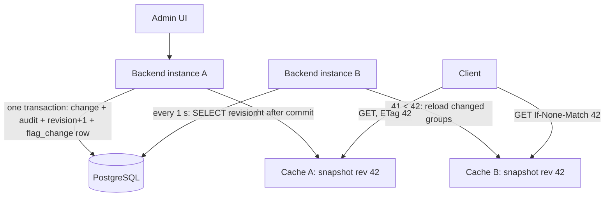

# Spec 003 — High availability with per-instance caches (release 1.2.0)

Owner-authored, locked. Decision: `decisions/0011-high-availability.md`.
Milestone: **M10**. Working branch: **`feature/high-availability`** (from `main`), one PR to `main`.
Spec folder (`<spec>` below): `docs/specs/003-high-availability/`.

This is a change spec, executed by an autonomous builder session. Every "MUST" is a hard
requirement. Section 10 records the owner's decisions.

## 1. Relation to `docs/SPEC.md`

`docs/SPEC.md` (spec 001) and spec 002 still apply. This spec changes only what it names. Where it
names a part of `docs/SPEC.md`, this spec wins for M10.

| `docs/SPEC.md` part | Change in M10 |
| --- | --- |
| 1.2 Non-goals: "Distributed cache … and horizontal scaling" | Horizontal scaling is in scope: the service MAY run as several instances. A distributed cache stays out of scope: each instance keeps its own Caffeine cache |
| 4.1 Tables | Adds `cache_state` (one row) and `flag_change` (the change log), Flyway `V3` (4.2) |
| 7.2 Caching: write path, `revision`, "Scope" and "Known limitation" paragraphs | Replaced by sections 4.3 to 4.7. Read path, warm-up, no-expiry and `maximumSize` rules stay |
| 7.2 Daily reconciliation | One instance under an advisory lock; drift increments the database revision (4.8) |
| 9.3 Observability | Adds the metrics and the alert of 4.10 |
| 9.4 Configuration | Adds `FF_CACHE_SYNC_INTERVAL`, `FF_CHANGE_RETENTION` (4.11) |
| 10.3 docker-compose | Two backend services; the UI proxy balances with an `upstream` block (4.12) |
| 11.2 AC-CACHE-4, AC-CACHE-6, AC-CACHE-7 | Re-expressed (table in section 5). The owner extends `docs/acceptance-criteria.md` |
| 13 "Multi-instance backend" row | The design hook becomes this spec |

Not changed: gate 4 banned dependencies (no Redis, no broker), `backend/openapi.json`, tech stack.

After the PR is merged, the owner updates `docs/SPEC.md` and `docs/acceptance-criteria.md`. The
agent never edits them or this file.

## 2. Goal

Run the backend as any number of instances (N ≥ 2) behind a load balancer, so a crash, a deploy or a restart
of one instance does not interrupt clients. **No change for clients**: same API, payloads, `ETag`
format, security. No new component to run.

Not in scope: Keycloak or other auth changes, targeting or rollouts, multiple environments, client
SDKs, high availability of PostgreSQL.

## 3. MUST stay the same

1. Every acceptance criterion of spec 001 and spec 002 passes, except those re-expressed in
   section 5.
2. HTTP behaviour for clients, byte for byte: status codes, headers, problem details, JSON,
   `ETag: "<revision>"`, body `revision`, `Cache-Control: no-cache`, `304` rules.
3. Security rules of spec 001 section 5. No new endpoint.
4. `backend/openapi.json` unchanged.
5. All 15 gates, thresholds, banned lists and test-integrity rules unchanged.
6. V1 and V2 migrations unchanged (same checksums).

## 4. Design

### 4.1 Architecture



1. An admin write runs in one transaction: the flag change, the audit row (as today), one
   increment of `cache_state.revision` under its row lock, and one `flag_change` row carrying the
   new revision. Revision order is therefore commit order, with no gaps.
2. After commit, the writing instance syncs its own cache before the HTTP response returns
   (read-your-write, as today).
3. Every instance runs a **syncer**: every `FF_CACHE_SYNC_INTERVAL` (default 1 s) it reads
   `cache_state.revision` with a plain query from the normal connection pool. If the database is
   ahead, it reloads the changed groups and swaps its in-memory snapshot.
4. Every Evaluation request is answered from the instance's snapshot. `ETag` is the snapshot's
   revision. Instances never talk to each other. Nothing is pushed; nothing can be missed.


### 4.2 Tables (Flyway V3)

`cache_state`: columns `id smallint primary key` (always 1) and `revision bigint not null`.
V3 inserts the single row with `revision = 0`.

`flag_change`:

| Column | Type | Rule |
| --- | --- | --- |
| `revision` | `bigint primary key` | The value returned by the increment in the same transaction |
| `type` | `varchar(20) not null` | `FLAG`, `GROUP`, `GROUP_DELETED`, `RECONCILE` |
| `group_key` | `varchar(100)` | The group to reload. `null` for `RECONCILE` |
| `created_at` | `timestamptz not null` | Server time |

- Every change that today increments `revision` (spec 7.2 table, including a group name or
  description edit) MUST run, inside its transaction and after its data writes:
  `UPDATE cache_state SET revision = revision + 1 WHERE id = 1 RETURNING revision`, then insert
  the `flag_change` row with that value. Rejected, failed and no-op writes do neither. A rollback
  rolls back both.
- **Lock span.** The row lock is held from the `UPDATE cache_state` statement to the commit and
  not longer. The increment and the `flag_change` insert MUST be the last two statements of the
  transaction: validation, the flag or group writes and the audit row run before them, in parallel
  across writers, and nothing may run between the increment and the commit. So writers are
  serialised only for the commit tail (a few ms), not for the whole transaction. `lock_timeout`
  for the increment: 5 s; on timeout the write fails with the existing 500 problem detail (an
  operational fault, not client input). Gate 13's admin p95 is the check that the span stays small.
- Retention: a daily job deletes `flag_change` rows older than `FF_CHANGE_RETENTION` (default
  `P1D`). `cache_state` is never reset.

**Known limit (owner note).** The single counter row is a serialisation point for all admin
writes. With a commit tail of a few ms it carries roughly a few hundred writes per second before
the queue grows; an admin UI stays far below that. It becomes a bottleneck only with intensive
automated updates on a large flag set. If gate 13 shows the admin p95 (spec 9.2) failing because
of this lock, that is the Level 3 trigger in section 7; the follow-up would be a different
revision source (for example a sequence plus a "visible up to" marker), not a change to the
read side. Not built in M10.

### 4.3 Snapshot

Each instance holds one immutable `Snapshot { long revision; Map all; Map<group, Map> groups }`
in a `volatile` field. A request reads that one reference, so its data and its `ETag` always come
from the same moment. This replaces the "read the revision before the data" rule of spec 7.2 and
the BF-1 workaround (`appliedSeq`, `loadedSeq`, `isLate`) in `FlagCacheService`. The three
Caffeine caches of spec 7.2 stay as the read structure; a swap replaces their content under the
existing `writeLock`.

### 4.4 Syncer

One per instance, one thread, started after warm-up.

1. Every `FF_CACHE_SYNC_INTERVAL`: `SELECT revision FROM cache_state`. If equal to the local
   revision, done.
2. Otherwise, in **one `REPEATABLE READ` transaction**: read `flag_change` rows with
   `revision > local` ordered by revision; load the groups they name (a `GROUP_DELETED` row removes
   the group); read `cache_state.revision` again; commit. Build the new snapshot from the current
   one plus these groups and swap it. Set local = the revision read inside the transaction.
3. If no `flag_change` row with `revision = local + 1` exists (retention deleted it, or local is
   0), do a **full reload** instead: all groups and flags and `cache_state.revision` in one
   `REPEATABLE READ` transaction, as the warm-up does.
4. A sync never lowers the local revision. A snapshot is swapped only if its revision is greater.
5. Errors: logged at WARN with the gap; the next tick retries. The service keeps serving the current
   snapshot. No backoff below 1 s, no backoff above 10 s.
6. Warm-up (spec 7.2) is a full reload (step 3) and sets the initial local revision.

### 4.5 Writing instance

After commit (the existing `AFTER_COMMIT` listener), the instance runs one sync (4.4 step 1 to 2)
synchronously, before the HTTP response returns. The `FlagsChangedEvent` payload is no longer
applied directly; the sync reloads from the database. Read-your-write holds on that instance.

### 4.6 ETag and the monotonic rule

- `ETag: "<revision>"` and body `revision` are the snapshot's revision. All instances give the
  same value for the same data; a restart gives the same value too.
- **Monotonic rule.** If a request carries `If-None-Match` with a number **greater** than the
  snapshot's revision, the instance runs one sync first (concurrent requests share one sync; a
  sync started this way times out after 2 s), then answers from the new snapshot. If the sync
  fails, the instance answers `304` with the client's ETag: the client keeps data at least as new
  as anything this instance could return. A client is therefore never shown an older revision after
  it has seen a newer one, whichever instance the load balancer picks.
- An unparsable or weak `If-None-Match` is treated as no match (today's behaviour).

### 4.7 Consistency bound

Normal operation: a change is visible on the writing instance before the HTTP response returns
and on every other instance within `FF_CACHE_SYNC_INTERVAL` (p99 ≤ 2 s with the default). An
instance that cannot reach the database keeps serving its last snapshot; that data cannot be
stale by a write it missed, because no write can commit without the database. The one stale case
is an instance cut off from the database while the others are not; 4.10 alerts on it.

### 4.8 Daily reconciliation

As spec 7.2, with these changes: one instance runs it, guarded by
`pg_try_advisory_xact_lock(<constant>)` (others skip the run and log at INFO); it compares its
snapshot with a `REPEATABLE READ` database snapshot taken at the same revision; if any drift is
found it fixes the local snapshot and, in one transaction, increments `cache_state.revision` and
inserts a `RECONCILE` row, so every instance does a full reload on its next tick and the `ETag`
changes. No drift: no row, no revision change (AC-CACHE-8 unchanged).

### 4.9 Readiness

UP after warm-up, as today. It does **not** depend on the database afterwards: a database outage
must not remove every instance from the load balancer while they can still serve correct data.
`/actuator/health` body unchanged.

### 4.10 Observability

New metrics: `ff_cache_revision` (gauge, per instance), `ff_cache_sync_age_seconds` (time since
the last successful sync), `ff_cache_syncs_total{result=noop|partial|full|error}`. Alert rule in
`ops/`: `ff_cache_sync_age_seconds > 30` for 1 min. Logs keep the ECS format; each partial or full
sync logs at DEBUG with the revision range, each error at WARN.

### 4.11 Configuration

| Variable | Default | Purpose |
| --- | --- | --- |
| `FF_CACHE_SYNC_INTERVAL` | `PT1S` | Syncer tick |
| `FF_CHANGE_RETENTION` | `P1D` | Retention of `flag_change` rows |

### 4.12 Deployment

**Images.** The product is the two images `feature-flag-backend` and `feature-flag-ui` plus a
PostgreSQL. They run anywhere Docker runs; instances need only the database, never each other
(AC-OPS-2 stays). `docker-compose.yml` is the local stack and the test rig for the gates and the
acceptance suite, not the deployment model.

**Compose (local, gates).** `backend` becomes two named services `backend-1` and `backend-2`
(same image, same environment). The host port mapping `8080:8080` moves to the UI proxy path: direct
API clients (k6, smoke) call `http://localhost:3000/api/...` or a new `backend-lb` nginx service
publishing 8080. The UI's nginx balances with an explicit `upstream` block:

```
upstream backend {
    server backend-1:8080 max_fails=2 fail_timeout=5s;
    server backend-2:8080 max_fails=2 fail_timeout=5s;
}
location /api/ { proxy_pass http://backend; ... }
```

Round-robin; a backend that fails twice is skipped for 5 s. Chosen over DNS-based resolution
because nginx resolves a name once at start and keeps a stale IP after a container restart unless
a `resolver` with a short TTL is configured. The UI image keeps `BACKEND_URL` as its default (one backend, AC-OPS-2 unchanged); the
`upstream` block is a compose-only override, mounted as the nginx config of the `frontend` service
in `docker-compose.yml`. The image itself does not change.

**ECS / Fargate (production reference, not built or tested in M10).** Backend: one task definition,
one service with `desiredCount ≥ 2`, an ALB target group with health check
`/actuator/health/readiness`, container health check `/actuator/health/liveness`. UI: its own
service behind the ALB; its nginx forwards `/api/` to the backend target group's name, so the ALB
does the balancing and no `upstream` block is needed there. Database: RDS for PostgreSQL. Secrets:
Secrets Manager or SSM into the task environment. Images: ECR, tagged as `make build-images` does.
No `depends_on`: the backend retries the database at start and runs Flyway itself. Rolling
deployment with minimum healthy percent 100 is the mixed-deployment case of 4.13.

### 4.13 Upgrade from 1.1

A 1.1 instance writes no `cache_state` increment, so a write through it during a mixed deployment
is invisible to 1.2 instances until reconciliation. **Decided: stop the 1.1 instance before starting
the first 1.2 instance** (a short outage, once). The README MUST state this for the 1.1 to 1.2
upgrade. Rolling deployments between 1.2 and later versions are supported (both write the
increment).

## 5. Acceptance criteria

Registered in `<spec>/acceptance-criteria.md` (`Due milestone: 10`): AC-HA-1 to AC-HA-10. "N"
there is any instance count ≥ 2; main code MUST NOT assume a fixed count. Tests use N = 3.

**Spec 001 criteria that change** (same ID, same position; the owner extends
`docs/acceptance-criteria.md` after merge):

| ID | Now | Becomes |
| --- | --- | --- |
| AC-CACHE-4 | Toggle, create and delete of a flag, and delete of a group, are each visible on the next evaluation call with zero database queries for that call | Same on the writing instance; on any other instance within `FF_CACHE_SYNC_INTERVAL` (p99 ≤ 2 s), zero database queries for the evaluation call itself |
| AC-CACHE-6 | The readiness probe reports DOWN until warm-up has finished | Same; and readiness stays UP when the database becomes unreachable after warm-up |
| AC-CACHE-7 | A flag changed directly in the database keeps its old cached value until reconciliation runs; after a reconciliation run (triggered in the test by calling the job), the next evaluation call returns the database value, a WARN is logged and the ETag changes | Same; and after that run every other instance returns the new value within 2 s, and the `ETag` changed |

AC-CACHE-1, 2, 3, 5, 8, 9 unchanged. Note for the builder: AC-CACHE-1 counts queries on
`EvaluationQueries`; the syncer MUST use its own repository so its tick is not counted.

## 6. Test changes

The tests that may change are listed in `<spec>/test-changes.md`.
Allowed behaviour changes: AC-CACHE-4, AC-CACHE-6, AC-CACHE-7.
Every other test may change only by the plumbing clause in that file. A change to any other
test is a Level 3 escalation (section 8).

## 7. Acceptance delta

For the black-box acceptance suite (`docs/VALIDATION.md`):

- Added: AC-HA-1 … AC-HA-10
- Changed: AC-CACHE-4, AC-CACHE-6, AC-CACHE-7: the suite scenarios gain an N-instance variant (a change on one instance checked on the others; readiness checked with the database stopped; reconciliation checked on every instance)
- Retired: none

## 8. Process

- Rules of spec 001 section 12 and `CLAUDE.md` apply. Commit messages `M10 <area>: <what>`, trailers
  `AC:` and `Spec: 003 §<n>`.
- First commit: the memory files in `<spec>/` (`STATE.md`, `PROGRESS.md`, `DECISIONS.md`,
  `BLOCKERS.md`, `MILESTONE` = `10`). After the first green chunk, one draft PR
  `feature/high-availability` → `main`.
- Phases, each chunk green: **A** V3 tables, the increment and `flag_change` insert in every write
  path, syncer and snapshot on one instance, BF-1 workaround removed (all old tests green);
  **B** monotonic ETag rule, reconciliation under the lock, metrics, multi-instance integration tests
  (three Spring contexts on one PostgreSQL; the count is a test parameter, never a constant in main code); **C** compose with two backend services, e2e and smoke gates,
  README, release 1.2.0 (`VERSION`, `CHANGELOG.md`).
- Milestone audit (`docs/builder-agents.md` section 5): `spec-auditor`, `test-auditor`,
  `security-reviewer`, `final-reviewer` (scope backend).

**Level 3 triggers for M10** (in addition to spec 001 12.5)

- A change would break an item of section 3.
- A test outside `<spec>/test-changes.md` would need more than a plumbing change.
- The only way to make a gate green is a new exception, exclusion or ignore entry.
- The row-lock serialisation makes the admin p95 (spec 9.2) fail under gate 13.

## 9. Definition of done

- [ ] `make verify-all` passes, all 15 gates, with the multi-instance compose stack; report committed as `<spec>/verify-report.md`.
- [ ] AC-HA-1 to AC-HA-10 and every spec 001 and 002 criterion (with section 5 changes) pass.
- [ ] Only the tests in `<spec>/test-changes.md` changed beyond plumbing.
- [ ] `V1`, `V2` unchanged; `V3` only adds the two tables; `openapi.json` unchanged.
- [ ] `VERSION` 1.2.0, `CHANGELOG.md` section, README section on several instances.
- [ ] Milestone audit done, no open BLOCKER or CRITICAL; no open escalation; PR ready with summary.

## 10. Owner decisions

1. ~~Redis / CDC~~ **Decided: no Redis, no Debezium.** Per-instance caches, 1 s revision poll,
   commit-ordered revision as ETag (architecture review of 2026-10-11, two independent reviewers).
2. ~~Load balancing in compose~~ **Decided: explicit nginx `upstream` block, compose-only override;
   the UI image keeps `BACKEND_URL` as its default** (4.12).
3. ~~Upgrade from 1.1~~ **Decided: stop the 1.1 instance before starting 1.2** (4.13).
4. ~~Retention~~ **Decided: `P1D`.**
5. ~~Release number~~ **Decided: 1.2.0.**
6. ~~`LISTEN/NOTIFY` doorbell~~ **Decided: not in M10; a later spec if the 1 s lag matters.**

7. ~~Template~~ **Decided: spec re-shaped to the `/write-spec` template on 2026-10-11** (sections 6 and 7 added; design unchanged).

Accepted by the owner on 2026-10-11.
